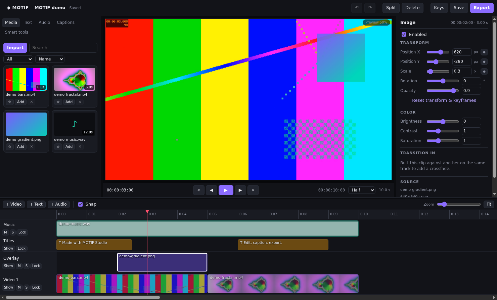

# MOTIF Studio

A local-first desktop video editor (Electron + React + TypeScript) with a real non-linear timeline, frame-accurate project model, FFmpeg render engine and verified exports. Inspired by the *breadth* of creator editors like CapCut Desktop; original brand, UI and code.



## What works today (tested)

- **Home**: new project (16:9, 9:16, 1:1, 4:5, 21:9 × 23.976–60 fps), open, recent list with search, rename, duplicate, remove, demo project generated locally with FFmpeg, autosave-recovery prompt.
- **Media**: import by dialog or drag-drop, real `ffprobe` metadata (codecs, size, rotation, VFR warning), thumbnails, filmstrips, waveform peaks, favorites, filter/sort/search, duplicate detection, missing-media detection and relink.
- **Timeline**: video / overlay / text / audio tracks, add/rename/hide/mute/solo/lock/delete tracks, drag-move across tracks, edge trim, split (S), ripple delete, lift, duplicate, snapping to edges/playhead/markers, markers, in/out points, zoom/fit, horizontal virtualization, undo/redo for every edit.
- **Preview**: canvas compositor driven by the same composition model as export (layers, transforms, keyframes, crossfades, opacity, color, titles), proxy-quality badge, frame stepping, playback with audio.
- **Inspector**: position/scale (keyframable, 5 easings), rotation, opacity, brightness/contrast/saturation, speed 0.25×–4× (pitch-preserving audio), volume/pan/fades, crossfade transitions, text content/size/color/box/position.
- **Captions**: caption clips, editable cue list, SRT import/export, captions burned into export.
- **Smart tools**: local silence detection → one-click cut + close gaps. Nothing leaves the machine.
- **Export**: presets (match project, 1080p, vertical, 720p draft, WebM VP9), CRF and speed, project-fps match, in/out range, progress + ETA, cancel (no partial file left), automatic output verification (streams, size, duration), show in folder, render log.
- **Project format**: versioned JSON (`.motif`), rational frame rates, integer-frame timeline, deterministic serialization, migrations, `.bak` backup, atomic writes, autosave to a recovery slot.
- **Security**: `contextIsolation`, `sandbox`, no `nodeIntegration`, typed preload bridge, zod-validated IPC with sender checks, strict CSP, media served only for imported assets, FFmpeg via argv arrays (no shell).

Not built yet (clearly disabled in the UI): speech-to-text auto captions, segmentation/reframe AI, cloud projects/accounts/billing (web app + API), installers signing. See `PROJECT_STATUS.md`.

## Quick start

Requirements: Node 22+, pnpm 10, FFmpeg + ffprobe on PATH (or `MOTIF_FFMPEG` / `MOTIF_FFPROBE`).

```bash
pnpm install
pnpm test                 # unit + render integration tests
pnpm dev:desktop          # launch the editor
pnpm build:desktop        # production bundle
pnpm --filter @motif/desktop package:linux   # AppImage/deb (also :win, :mac)
```

Linux headless smoke test (drives the real UI, exports a file, writes screenshots):

```bash
MOTIF_SMOKE_DIR=$PWD/tests/output/smoke pnpm --filter @motif/desktop smoke
```

## Layout

```
packages/project-schema   versioned project schema (zod), migrations, presets
packages/editor-core      rational timebase, timeline commands, undo/redo, composition evaluation, SRT
packages/render-engine    ffprobe import, thumbnails/peaks/proxies, FFmpeg graph builder, render + verify, silence detect
apps/desktop              Electron main / preload / React renderer
docs/                     architecture, ADRs, format, status
```

## v0.2 — liquid glass + CapCut-class tools
See `docs/CAPCUT_RESEARCH.md` for the full feature parity matrix.

Optional local AI (auto captions): `pip install faster-whisper` (Python 3.9+). Set `MOTIF_PYTHON` to use a specific interpreter.
The Whisper model (tiny/base/small) downloads once from Hugging Face on first use; audio never leaves the machine.
Text-to-speech uses FFmpeg's libflite, stabilization uses vid.stab — both ship with standard FFmpeg builds.
Bundled fonts (DejaVu, Poppins, Bebas Neue, Anton, Playfair Display, Pacifico, Lobster) are OFL/Bitstream-licensed.
