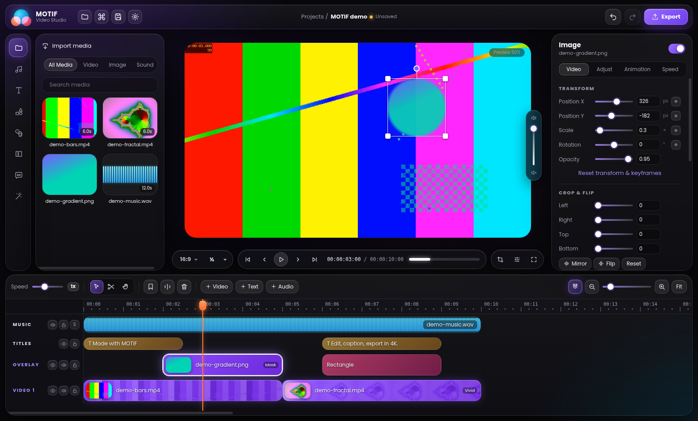

# MOTIF Studio

[](https://github.com/bileldh-ing/motif_studio/actions/workflows/ci.yml)
[](https://github.com/bileldh-ing/motif_studio/actions/workflows/release.yml)
[](https://github.com/bileldh-ing/motif_studio/actions/workflows/codeql.yml)

A **local-first desktop video editor** with a liquid-glass UI, CapCut-class creator tools, on-device AI and verified exports up to 4K — plus an optional **cloud** for versioned projects, teams and billing. Original brand, UI and code; not affiliated with CapCut/ByteDance.



🎬 **Tutorial video:** see the [`tutorial` release](https://github.com/bileldh-ing/motif_studio/releases/tag/tutorial) — recorded from the real app by CI, narrated offline, and edited & rendered by MOTIF's own engine.

## Features

| Area | What you get |
|---|---|
| Editing | Multitrack timeline, blade (B), select (V), hand (H), trim, ripple delete, lift, copy/paste, duplicate, freeze frame, reverse, speed 0.25–4×, markers, in/out, snapping, unlimited undo |
| Canvas | Figma-style on-canvas move/scale/rotate with value chips and snap guides, custom cursors per tool, crop, mirror/flip |
| Look | 10 filter looks, brightness/contrast/saturation/temperature/hue/sepia/grayscale/blur/vignette/invert, masks (rect/ellipse, feather, invert), chroma key, blurred background fill |
| Motion | Keyframes with 5 easings (position, scale, rotation, opacity, volume), 7 transitions, in/out animations |
| Text | Fonts (Poppins, Bebas Neue, Anton, Playfair, Lobster, Pacifico, DejaVu), stroke, shadow, boxes, presets, shapes |
| Local AI | Whisper auto captions (word timing), offline text-to-speech, noise reduction, voice changer, stabilization, silence removal, extract audio — nothing leaves your machine |
| Export | 480p–4K or custom, 24–60 fps, H.264/HEVC/AV1/VP9/ProRes, CRF or Mbps, AAC/Opus/MP3/PCM, GIF, audio-only, PNG still, size estimate, automatic output verification |
| Cloud (optional) | Browser/device sign-in, versioned cloud projects, restore any version, conflict resolution (keep both / overwrite), SHA-256-verified media transfer with dedupe, team workspaces with roles, plans & usage, Stripe billing |
| Ops | Auto-update, crash recovery + logs, diagnostic bundle, `.motif` file association, **no telemetry** |

## Repository

```
apps/desktop      Electron + React editor (main, preload, renderer), electron-builder.yml, demo director
apps/api          Fastify cloud API · PostgreSQL (Drizzle, SQL migrations) · signed storage · Stripe
apps/web          Next.js web app (marketing, account, cloud projects, billing, team, device approval, admin)
packages/project-schema   zod project schema + migrations
packages/editor-core      rational timebase, timeline ops, undo, shared composition model
packages/render-engine    ffprobe import, FFmpeg graph builder, render + verify, local AI tools
packages/cloud-client     desktop ⇄ cloud sync (upload/download, conflicts, integrity)
scripts/                  FFmpeg bundling, tutorial-video narration
docs/                     ADRs, feature matrix, CapCut research, release/store checklist, threat model, privacy, operations
```

## Quick start

Requirements: Node 22+, pnpm 10, FFmpeg 7+ on PATH (release builds bundle it).

```bash
pnpm install
pnpm test                 # all tests (embedded PostgreSQL is started automatically for API tests)
pnpm dev:desktop          # the editor
docker compose up         # cloud API + PostgreSQL on :8787 (optional)
pnpm dev:web              # web app on :3000 (NEXT_PUBLIC_API_URL=http://localhost:8787)
```

Auto captions: `pip install faster-whisper` (set `MOTIF_PYTHON` if Python is elsewhere).

## CI/CD

- **CI** (every push/PR): typecheck · unit/render/effects/API/sync tests on Debian trixie + FFmpeg 7.1 + PostgreSQL 17 + Whisper · Next.js build · API container boot · Electron UI smoke test under Xvfb (screenshots as artifacts) · unsigned installers for Windows, macOS and Linux with a packaged-app launch check.
- **Release** (tag `vX.Y.Z`): builds NSIS + Microsoft Store appx, dmg/zip (arm64+x64), AppImage/deb/snap; signs and notarizes when secrets exist; publishes the GitHub Release used by auto-update; uploads checksums and store packages. See [docs/RELEASE.md](docs/RELEASE.md).
- **Tutorial video** workflow: records the real app driving every feature, narrates with Piper, renders the edit with MOTIF.
- **CodeQL** + **Dependabot**.

## Docs

[Project status](PROJECT_STATUS.md) · [Changelog](CHANGELOG.md) · [Feature matrix](docs/FEATURE_MATRIX.md) · [CapCut research](docs/CAPCUT_RESEARCH.md) · [Release & stores](docs/RELEASE.md) · [Operations](docs/OPERATIONS.md) · [Threat model](docs/THREAT_MODEL.md) · [Privacy](docs/PRIVACY.md) · [Third-party notices](THIRD_PARTY_NOTICES.md)

## License

© 2026 Bilel Dhahri. FFmpeg is bundled as a separate executable under its own license (see THIRD_PARTY_NOTICES.md).
